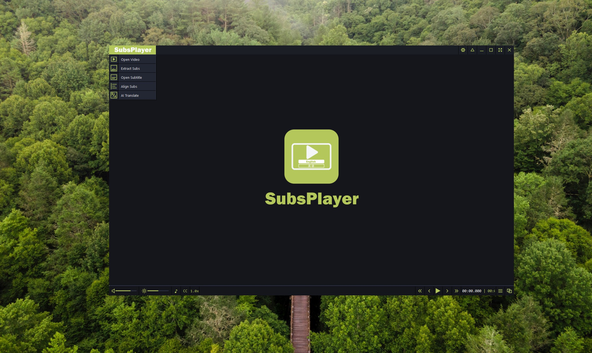
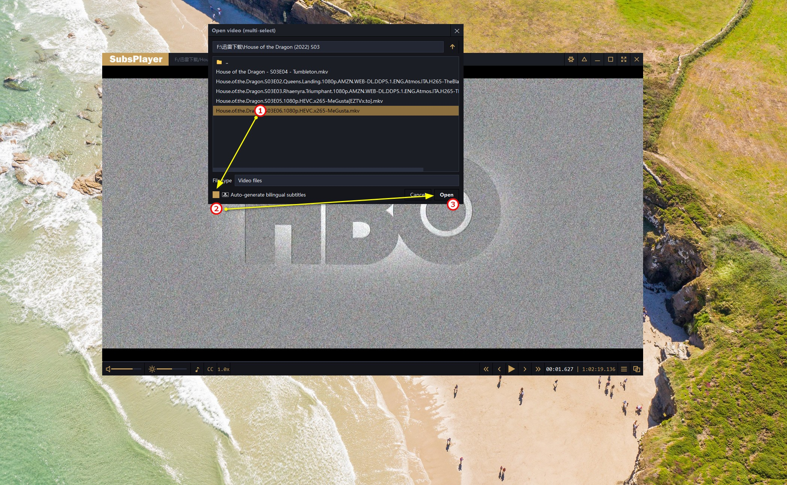
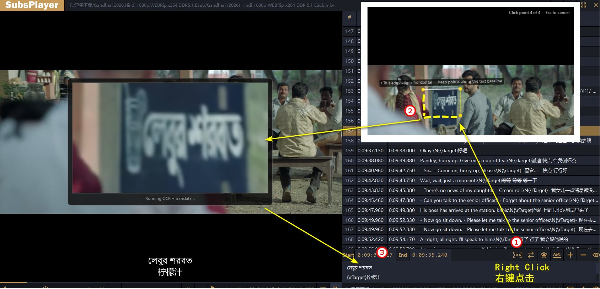
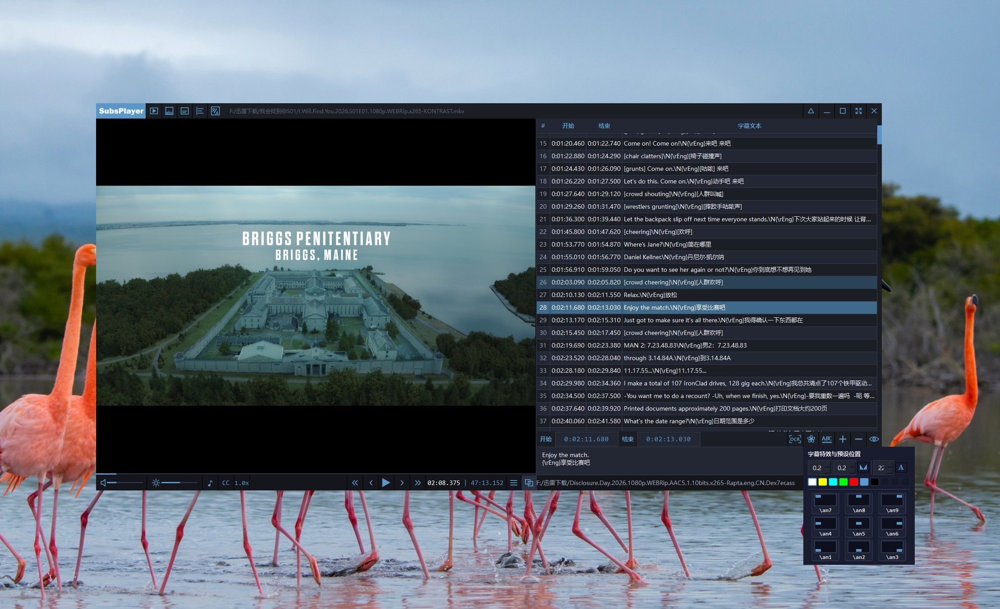

<p align="center">
  
</p>

<p align="center">
  
  
  
</p>

<p align="center">
  English | <a href="README_CN.md">中文</a>
</p>

SubsPlayer is not only a Windows video player, but also a subtitle editor built for subtitle workflows. It covers the full pipeline — **extract → align → translate → edit → hard-sub OCR → effects** — with features tuned for common pain points in bilingual subtitle production.

## New features and highlights

* **Automatic transcription and translation for videos without subtitles:** generate a source SRT and bilingual ASS directly from speech, without an existing subtitle file. The result loads automatically for playback, review, and editing.
* **Enter player-only mode in one click:** right-click **Switch layout** to hide the subtitle browser and give the video the main window. Left-click the button to cycle through editing layouts. The app remembers the layout and player mode when you close it.
* **Edit subtitles in player-only mode:** enable **Edit subtitles in player** in Settings, then click the active external subtitle area near the bottom of the video. Playback pauses and a floating editor opens for source text, translation, timing, and styling. Save and resume when finished.
* **Segment transcription with translation:** choose a video time range and language to fill in missing dialogue, optionally translating it with AI and adding the results to the current subtitles.
* **More subtitle tools:** right-click to retranslate, merge, split, or shift selected rows; use rectangular or custom four-point OCR; export ASS / SRT or multiple versions in a ZIP.

> Automatic transcription and translation for videos without subtitles require a valid Gemini API key and access to the AI service. Simultaneous translation uses your current translation settings, including target language, glossary, and bilingual order. Playback, manual editing, and local subtitle synchronization do not require AI credentials.


---

## 🖥 Screenshots

### Player home



> Dark-themed player home: Open Video / Extract Subs / Open Subtitle / Align / AI Translate on the left; volume, brightness, audio track, CC, speed and transport controls along the bottom.

### Open video & auto-generate bilingual subtitles



> For videos with embedded subtitles, enable **Auto-generate bilingual subtitles** when opening to extract and translate them automatically. For videos without usable subtitles, use **Generate Subtitles** to transcribe and translate speech.

### Hard-sub OCR



> ① Click **OCR** in the editor → ② drag-select the burned-in text on the video → ③ recognize & translate, then insert at the current time.

### Basic ASS effects & position presets



> After selecting a line, use the color palette and `\an1`–`\an9` alignment grid to insert style and position tags. Drag across grid cells to create a movement effect in the corresponding direction. Fade-in and fade-out effects are also supported, with live preview.

---

## ✨ Key Features

*   **Automatic speech transcription and translation** — generate a source SRT and bilingual ASS from the selected audio track, with automatic loading on completion; selected time ranges are supported
*   **One-click player mode and in-player subtitle editing** — right-click the layout button to enter player-only mode, then click subtitles to edit after enabling the setting
*   **Automated timeline alignment** — fix offset/drift using the current video audio track or a known-good reference subtitle
*   **AI translation engine**
    *   Gemini REST API supported
    *   **Resume from breakpoint** — recover from omitted, truncated, or interrupted jobs
    *   **Pre-cleaning + auto glossary** — strip speaker prefixes and bracket noise; keep names/places consistent
    *   **Bilingual ASS output** — mono/bilingual, plus original/translation ordering
*   **Visual editor**
    *   Per-digit timestamp** tweaking with mouse wheel**; **video seeks** in sync
    *   Five layouts: player-only / editor right / left / video on top / **detached dual-window**
*   **Hard-sub OCR + basic ASS effects** — region select on video; color + 9-grid alignment presets
*   **Internationalized UI** — Chinese, English, Japanese, Korean, Vietnamese, Indonesian, Portuguese, Spanish, French

---

## 🚀 Install & Use

*   Download the installer from [SubsPlayer.com](https://SubsPlayer.com) or the GitHub Release page, then run the exe.

### As a player

> **Player-only mode / extract / align / manual edit** need no API key. After install you can play video and load external subs without configuring a key.

### Switch to player-only mode and edit while watching

1. **Enter player-only mode.** Right-click **Switch layout** in the player to hide the subtitle browser. Left-click the button to switch to an editing layout when needed.
2. **Enable in-player editing.** Turn on **Edit subtitles in player** in Settings (off by default) and load editable external subtitles. Extract embedded subtitles first.
3. **Click to edit.** While a subtitle is visible, click its area near the bottom of the video. Playback pauses and a floating editor opens. Edit the source, translation, timing, or styling, with changes previewed in the video.
4. **Save and keep watching.** Click Save to save and close the editor, or use **Save and resume** / `Ctrl+Enter` to save and continue playback.

### Videos without subtitles: speech to bilingual subtitles

1. Sign in with your Google account and follow the link to obtain a free **Gemini API key**. Enter the key in Settings, then choose the translation target language and bilingual order.
2. Click **Generate Subtitles** in the main menu and choose a video. If it has multiple audio tracks, first select the track you want to transcribe in the player.
3. Leave **Translate subtitles with AI while transcribing** checked in the confirmation dialog, then click **Start**. Uncheck it to generate source subtitles only.
4. The app processes speech, generates timings, and translates batches automatically. It saves a **source SRT + bilingual ASS** next to the video and loads the result on completion for review, editing, and export.
5. To fill in only a short section, click the **transcription button** immediately to the left of the subtitle styling button in the editor toolbar. Choose a start time, end time, and language, and optionally enable simultaneous translation.

> **Auto-generate bilingual subtitles** in the Open Video dialog extracts and translates **existing embedded subtitle tracks**. Use **Generate Subtitles** for videos without subtitles.

## Recommended subtitle translation & edit workflow (API key required)

1. **Import video** — Open Video or drag files in; enable **Auto-generate bilingual subtitles** if embedded subtitle tracks are available
2. **Prepare subtitles** — extract embedded tracks to external SRT, or use **Generate Subtitles** with AI translation enabled to create bilingual subtitles directly from speech
3. **Align timing** — if A/V is out of sync, Align Subs against the current audio track or a reference SRT
4. **AI Translate** — select the SRT, set target language / bilingual / cleaning / glossary; multiple keys rotate automatically
5. **Review and export** — edit in a full editing layout or player-only mode; use OCR, segment transcription, and styling as needed, then save or export ASS / SRT / multiple versions in a ZIP

---

## 🔑 Gemini API Key — Obtain & Configure

> **Speech transcription with optional translation, AI Translate, hard-sub OCR, and auto-generate bilingual subtitles** use online AI services. Speech transcription requires a valid Gemini API key; the following guide explains how to obtain and configure one.

### 1. Sign in via the Google button and create a free API key in Google AI Studio

Click the Google button in the app, sign in to your account, and follow the link to Google AI Studio.

1. Alternatively, open the official page in your browser:  
   **[https://aistudio.google.com/apikey](https://aistudio.google.com/apikey)**

2. Sign in with a Google account and accept the terms.

3. Click **Create API key**:
   *   Beginners: **Create API key in new project** (auto-creates a Cloud project)
   *   Or: **Create API key in existing project**

4. Copy the full key immediately (usually starts with `AIza`).  
   Keep it private — do not post it in public chats, screenshots, or git repos.

5. (Optional) For heavy workloads, create keys under **multiple Google accounts** and paste them one-per-line in the app for automatic rotation and higher throughput.

> **Free quotas and model limits change with Google policy — check official docs:**  
> **[Gemini API docs](https://ai.google.dev/gemini-api/docs) · [Rate limits / pricing](https://ai.google.dev/gemini-api/docs/rate-limits)**

### 2. Paste the key into SubsPlayer

1. Launch SubsPlayer → click the **gear (Settings)** at the top-right.

2. Open the **AI Translate** tab (first tab by default).

3. Confirm the provider is **Gemini**; keep the default model unless you know you need another.

4. In the **API Keys** box, paste keys:
   *   **One key per line**
   *   No quotes, commas, or `Bearer` prefixes
   *   Multi-key example:
     ```text
     AIzaSyxxxxxxxxxxxxxxxxxxxxxxxxxxxxxxx1
     AIzaSyxxxxxxxxxxxxxxxxxxxxxxxxxxxxxxx2
     AIzaSyxxxxxxxxxxxxxxxxxxxxxxxxxxxxxxx3
     ```

5. Tune rate limits if needed (defaults are usually fine):
   *   **RPM (requests/minute)** — default ~`14`; too high invites official throttling
   *   **RPD (requests/day)** — job stops for the day when reached
   *   **Batch lines** — lines per request; too large may truncate, too small slows down

6. Set default target language, bilingual options, glossary, etc., then **Save**.

### 3. Network & proxy (especially important in mainland China)

The app calls Gemini via the official endpoint:

`https://generativelanguage.googleapis.com/...`

*   If that host is unreachable, translate/OCR will time out or fail — ensure the machine can reach the domain (system proxy / VPN, etc.)
*   SubsPlayer follows the system proxy; confirm AI Studio loads in a browser first, then retry in-app
*   Error “Missing API Key”: reopen Settings, confirm keys are non-empty and saved
*   429 / quota errors: lower RPM, add spare keys, or retry later

---

## ⚙ FAQ

1. **Missing API Key?**  
   Open **Settings → AI Translate**, paste keys as above and Save. OCR and AI Translate share the same keys.

2. **Translate is slow / always fails, or OCR errors?**  
   First confirm access to `generativelanguage.googleapis.com`; then check key validity and RPM; add more keys for rotation if needed.

3. **Playback works, but all AI features fail?**  
   Usually missing keys or no route to Google’s API — unrelated to the player core.


4. **Which option should I use if the video has no subtitles at all?**  
   Use **Generate Subtitles** and leave **Translate subtitles with AI while transcribing** checked. The Open Video option **Auto-generate bilingual subtitles** requires an existing embedded subtitle track.

5. **Clicking subtitles in player-only mode does not open the editor?**  
   Enable **Edit subtitles in player** in Settings and load editable external subtitles. Click the lower subtitle area while a cue is visible. Embedded or burned-in subtitles must first be extracted, transcribed, or recognized with OCR to create editable subtitles.

---

## 🙏 Acknowledgements

SubsPlayer stands on the shoulders of these excellent open-source projects and services:

| Component | Author / Team | Homepage |
| :-------- | :------------ | :------- |
| **FFmpeg** | FFmpeg team | https://ffmpeg.org |
| **FFmpeg Windows builds** | Gyan Doshi | https://www.gyan.dev/ffmpeg/ |
| **mpv / libmpv** | mpv-player team | https://mpv.io · https://github.com/mpv-player/mpv |
| **ffsubsync** | smacke & contributors | https://github.com/smacke/ffsubsync |
| **Qt / PySide6** | The Qt Company | https://doc.qt.io/qtforpython/ |
| **python-mpv** | jaseg | https://github.com/jaseg/python-mpv |
| **pysubs2** | Tomáš Karabela | https://github.com/tkarabela/pysubs2 |
| **Requests** | Kenneth Reitz & contributors | https://requests.readthedocs.io |
| **Google Gemini API** | Google | https://ai.google.dev |
| **Claude** (dev assistant) | Anthropic | https://claude.com |

---

## ✨ What You Need to Know

* All rights reserved by SubsPlayer.
* By downloading and using this software, you agree to share automatic translation results and subtitle files embedded in videos with other users. If you object to this, please do not use this software.
* Thank you to Google for providing the free API. This software will not share your API key; I have my own paid API.
* Commercial use is strictly prohibited.
* Please comply with local laws and regulations.
* Technology is innocent. Long live open source!
