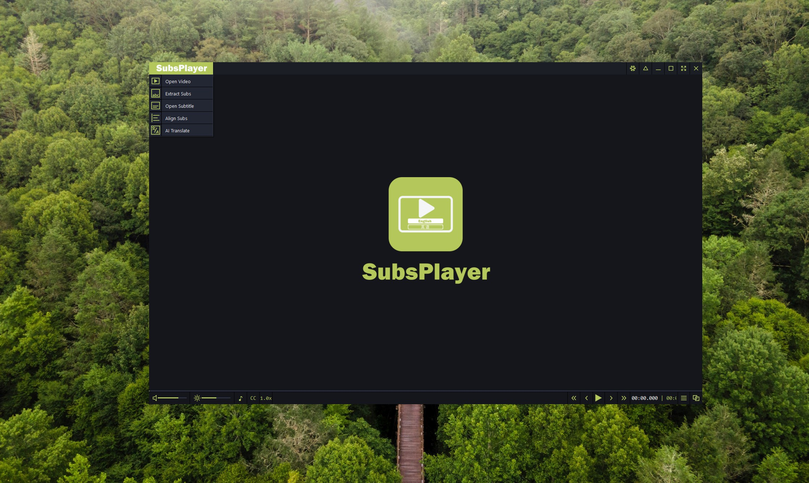
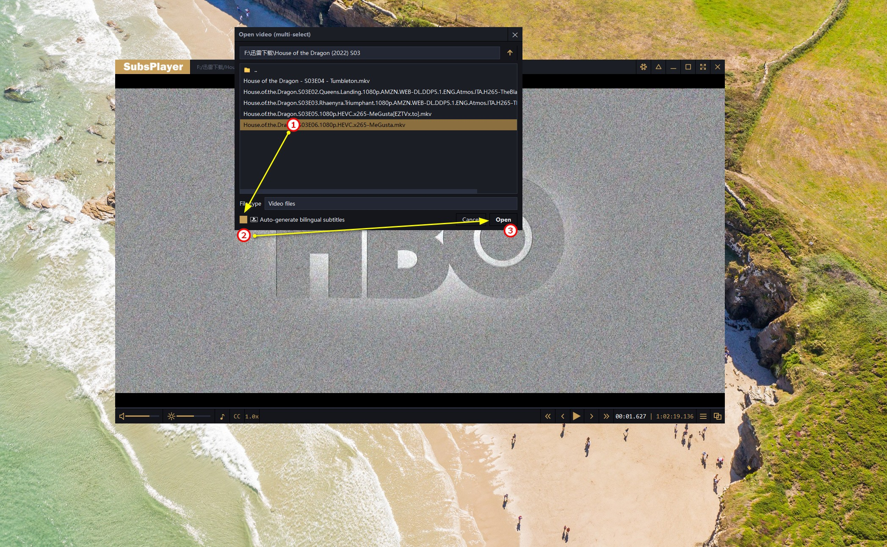
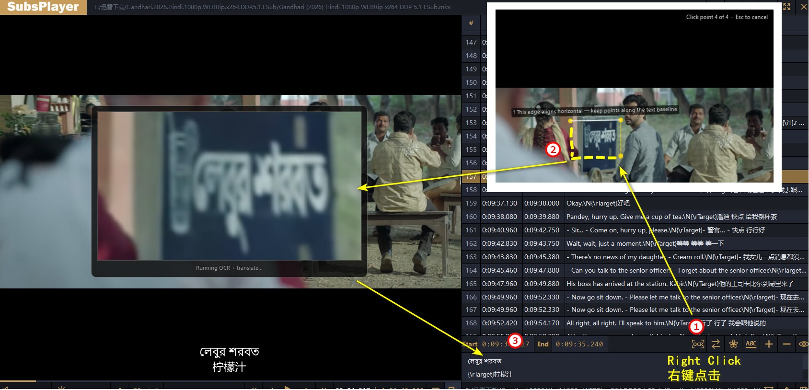
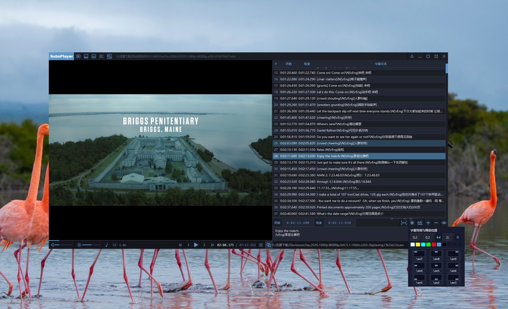

<p align="center">
  
</p>

<p align="center">
  
  
  
</p>

<p align="center">
  <a href="README.md">English</a> | 中文
</p>

SubsPlayer 不仅仅是一款 Windows 视频播放器，也是一款面向字幕工作者的字幕编辑器，打通了 **提取 → 对齐 → 翻译 → 编辑 → OCR 硬字幕 → 特效** 这一字幕编辑工作的全部流程，并且基于字幕制作的常见痛点做了针对性的功能优化设计

## 新增与重点功能

* **无字幕视频自动转写并翻译**：无需预先准备字幕文件，根据视频语音自动生成原文 SRT 和双语 ASS，完成后自动加载，可直接观看、校对和编辑。
* **一键播放器模式**：右键点击「切换布局」按钮，直接隐藏字幕浏览器，让视频独占主窗口；左键点击该按钮可继续切换编辑布局。程序会记住退出时的布局和播放器模式。
* **播放器模式支持字幕编辑**：在设置中开启「播放窗口支持字幕编辑」，点击画面下方正在显示的外挂字幕区域，即可暂停视频并打开浮动编辑区，修改原文、译文、时间和样式，保存后继续播放。
* **局部转写与翻译**：指定视频时间范围和语种，补充遗漏对白；可同时启用 AI 翻译，将结果加入现有字幕。
* **更多字幕工具**：支持右键重译、合并、拆分、批量提前或延迟；矩形或四点自定义区域 OCR；ASS / SRT 导出及多版本 ZIP 打包。本地自动对齐已使用 ffsubsync 替代 alass。

> 语音转写需配置可用的 Gemini API Key，并能连接相应 AI 服务。同时翻译使用当前翻译配置中的目标语言、术语表和双语顺序。视频播放、手工编辑和本地字幕对齐无需 AI 授权。

 
---

## 🖥 界面预览

### 纯播放器启动页



> 深色主题播放器首页：左侧为打开视频 / 提取字幕 / 打开字幕 / 对齐 / AI 翻译等入口，底部为音量、亮度、音轨、CC、倍速与播放控制

### 打开视频并启用自动生成双语字幕



> 含内封字幕的视频，可在打开时勾选「自动生成双语字幕」，自动提取并翻译字幕。没有可用字幕的视频，请使用「生成字幕」，根据语音自动转写并翻译。

### OCR 框选硬字幕



> ① 点击编辑区 **OCR** → ② 在画面上拖拽框选硬字幕区域 → ③ 识别并翻译，结果自动插入当前时点

### ASS 基本特效与位置预设



> 选中字幕行后，可用预设色板与 `\an1`–`\an9` 对齐，在多个格子上划动会自动匹配移动特效的代码，支持快速写入样式与位置标签，支持淡入淡出，画面实时预览

---

## ✨ 核心特性

*   **无字幕视频自动转写与翻译**：根据所选音轨生成原文 SRT 和双语 ASS，完成后自动加载；支持指定时间段
*   **一键播放器模式与画面内字幕编辑**：右键布局按钮直接进入播放器模式，开启编辑设置后可点击字幕修改
*   **自动化时间轴对齐**：可用当前视频音轨或已校对的参考字幕修正偏移与漂移
*   **AI 智能翻译引擎**
    *   现已支持Gemini REST API
    *   **断点续翻**：应对漏译、截断与中途中断
    *   **预清洗 + 自动术语表**：去掉角色名前缀与括号注释；提取人名地名等并保持译法一致
    *   **双语 ASS 输出**：可选单语 / 双语，以及原文、译文上下顺序
*   **可视化编辑器**
    *   **时间戳**任意数位**滚轮微调**，视频**实时跟跳**
    *   五种布局：纯播放器 / 编辑器在右 / 在左 / 播放器在上 / **双窗口分离**
*   **硬字幕 OCR + 基础 ASS 特效**：画面框选识别并翻译；预置颜色与九宫格对齐
*   **国际化界面**：中、英、日、韩、越、印尼、葡、西、法

---

## 🚀 安装与使用

*   通过SubsPlayer.com主页链接或者Release页下载exe安装运行即可

### 作为播放器

> **纯播放器模式 / 提取 / 对齐 / 手工编辑**，无需配置 API Key ，安装后可直接播放视频、加载外挂字幕，**无需**配置 API Key


### 一键切换播放器模式，允许边看边改字幕

1. **进入播放器模式**：右键点击播放器的「切换布局」按钮，隐藏字幕浏览器。需要完整编辑布局时，左键点击该按钮切换。
2. **开启画面内编辑**：在设置中勾选「播放窗口支持字幕编辑」（默认关闭），并加载可编辑的外挂字幕；内封字幕需先提取。
3. **点击字幕修改**：字幕显示时，单击画面下方字幕区域，视频自动暂停并打开浮动编辑区。可修改原文、译文、时间与样式，修改会在画面中预览。
4. **保存并继续观看**：点击保存按钮可保存并收起编辑区；点击「保存并继续播放」或按 `Ctrl+Enter` 可保存后继续播放。

### 无字幕视频：从语音自动生成双语字幕

1. 在设置中配置可用的 **Gemini API Key**，并设置翻译目标语言和双语显示顺序。
2. 点击主菜单的 **「生成字幕」**，选择需要处理的视频；有多个音轨时，先在播放器中选好需要转写的音轨。
3. 在确认窗口保留默认勾选的 **「转写字幕同时使用AI翻译」**，点击 **「开始生成」**。取消勾选则仅生成原文字幕。
4. 程序自动处理语音、生成时间轴并分批翻译，在视频同目录保存 **原文 SRT + 双语 ASS**。生成结束后自动载入，可继续校对、编辑和导出。
5. 如只需补充某段对白，点击编辑栏中字幕样式按钮左侧的 **转写按钮**，设置开始、结束时间和语种，再按需开启同时翻译。

> 打开视频时的「自动生成双语字幕」用于**已有内封字幕的提取与翻译**；无字幕视频的入口是「生成字幕」，不会因勾选前者而自动转入语音转写。

## 字幕翻译与编辑推荐流程，需已配置 Key

1. **导入视频**：点击「打开视频」或拖入文件；有内封字幕时可勾选「自动生成双语字幕」
2. **准备字幕**：有内封字幕时可提取为外部 SRT；无字幕时使用「生成字幕」，勾选同时 AI 翻译即可直接生成双语字幕
3. **时间对齐**：若音画不同步，点击「对齐字幕」，以当前音轨或参考 SRT 为基准对齐
4. **AI 翻译**：选中 SRT，点击「AI 翻译」，设定目标语言、双语、清洗与术语表；多 Key 会自动轮换
5. **可视化校对与导出**：在完整编辑布局或播放器模式下修改字幕；按需使用 OCR、局部转写与样式工具，保存或导出 ASS / SRT / 多版本 ZIP

---

## 🔑 Gemini API Key 获取与配置

> **语音转写及同时翻译、AI 翻译、硬字幕 OCR、自动生成双语字幕**涉及在线 AI 服务。语音转写需配置可用的 Gemini API Key；

### 一、在 Google AI Studio 申请 Key

1. 使用浏览器打开官方页面：  
   **[https://aistudio.google.com/apikey](https://aistudio.google.com/apikey)**  

2. 使用 Google 账号登录，并同意相关服务条款

3. 点击 **Create API key（创建 API 密钥）**：
   *   新手推荐：**Create API key in new project**（自动新建 Cloud 项目）
   *   若已有 Cloud 项目：选择 **Create API key in existing project**
   
4. 创建成功后，立刻复制整串密钥（通常以 `AIza` 开头）  
   请自行妥善保存；不要发到公开群聊、截图或提交到 Git 仓库  
   
5. （可选）若翻译量大，可用**多个 Google 账号**各申请一把 Key，在软件里多行粘贴，启用自动轮换以提高吞吐

> **免费额度与模型配额会随 Google 政策调整，请以官方说明为准：  
> **[Gemini API 文档](https://ai.google.dev/gemini-api/docs) · [配额与定价](https://ai.google.dev/gemini-api/docs/rate-limits)

### 二、在 SubsPlayer 中填入 Key

1. 启动 SubsPlayer，点击窗口右上角 **齿轮（设置）**

2. 打开 **「AI 翻译」** 选项卡（默认第一个）

3. 确认提供商为 **Gemini**，模型建议保持默认

4. 在 **API Keys** 多行文本框中粘贴密钥：
   *   **每行一个** Key
   *   不要加引号、逗号或 `Bearer` 等前缀
   *   多 Key 示例：
     ```text
     AIzaSyxxxxxxxxxxxxxxxxxxxxxxxxxxxxxxx1
     AIzaSyxxxxxxxxxxxxxxxxxxxxxxxxxxxxxxx2
     AIzaSyxxxxxxxxxxxxxxxxxxxxxxxxxxxxxxx3
     ```
     
5. 按需调整限流（默认一般可用）：
   *   **RPM（每分钟请求数）**：默认约 `14`，过大会更容易触发官方限流
   *   **RPD（每日请求数）**：默认较大；达到后当日任务会停止
   *   **每批行数**：控制单次请求字幕行数，过大可能截断，过小会变慢
   
6. 设置默认目标语言、是否双语、术语表等，点击 **保存**

### 三、网络与代理（国内用户尤其重要）

软件通过官方端点访问 Gemini：

`https://generativelanguage.googleapis.com/...`

*   若该地址无法直连，翻译与 OCR 会超时或失败请先保证本机可访问上述域名（系统代理 / 科学上网等）
*   SubsPlayer 会跟随系统代理设置；请先确认浏览器或系统代理已能打开 AI Studio，再在软件内重试
*   报错「缺少 API Key」：回到设置确认 Keys 非空且已点保存
*   报错 429 / 配额相关：降低 RPM、增加备用 Key，或稍后再试

---

## ⚙ 常见问题 (FAQ)

1. **提示缺少 API Key？**  
   打开 **设置 → AI 翻译**，按上文粘贴 Key 并保存OCR 与 AI 翻译共用同一组 Keys

2. **翻译很慢、一直失败，或 OCR 报错？**  
   先确认能访问 `generativelanguage.googleapis.com`；再检查 Key 是否有效、RPM 是否过高；可增加多把 Key 做轮换

3. **只有播放相关功能正常，AI 功能全部不可用？**  
   通常是未配置 Key，或网络到 Google API 不通，与播放内核无关

4. **视频完全没有字幕，应该使用哪个入口？**  
   使用「生成字幕」，保留勾选「转写字幕同时使用AI翻译」。

5. **播放器模式下点击字幕没有出现编辑区？**  
   在设置中开启「播放窗口支持字幕编辑」，并加载可编辑的外挂字幕。字幕需正在显示，点击位置应在画面下方字幕区域。

---

## 🙏 鸣谢

SubsPlayer 站在这些优秀开源项目与服务的肩膀上：

| 组件 | 作者 / 团队 | 主页 |
| :--- | :--------- | :--- |
| **FFmpeg** | FFmpeg team | https://ffmpeg.org |
| **FFmpeg Windows 构建** | Gyan Doshi | https://www.gyan.dev/ffmpeg/ |
| **mpv / libmpv** | mpv-player team | https://mpv.io · https://github.com/mpv-player/mpv |
| **ffsubsync** | smacke & contributors | https://github.com/smacke/ffsubsync |
| **Qt / PySide6** | The Qt Company | https://doc.qt.io/qtforpython/ |
| **python-mpv** | jaseg | https://github.com/jaseg/python-mpv |
| **pysubs2** | Tomáš Karabela | https://github.com/tkarabela/pysubs2 |
| **Requests** | Kenneth Reitz & contributors | https://requests.readthedocs.io |
| **Google Gemini API** | Google | https://ai.google.dev |
| **Claude**（辅助开发） | Anthropic | https://claude.com |

---
## ✨What You Need to Know

* All rights reserved by SubsPlayer.
* By downloading and using this software, you agree to share automatic translation results and subtitle files embedded in videos with other users. If you object to this, please do not use this software.
* Thank you to Google for providing the free API. This software will not share your API key; I have my own paid API.
* Commercial use is strictly prohibited.
* Please comply with local laws and regulations.
* Technology is innocent. Long live open source!
